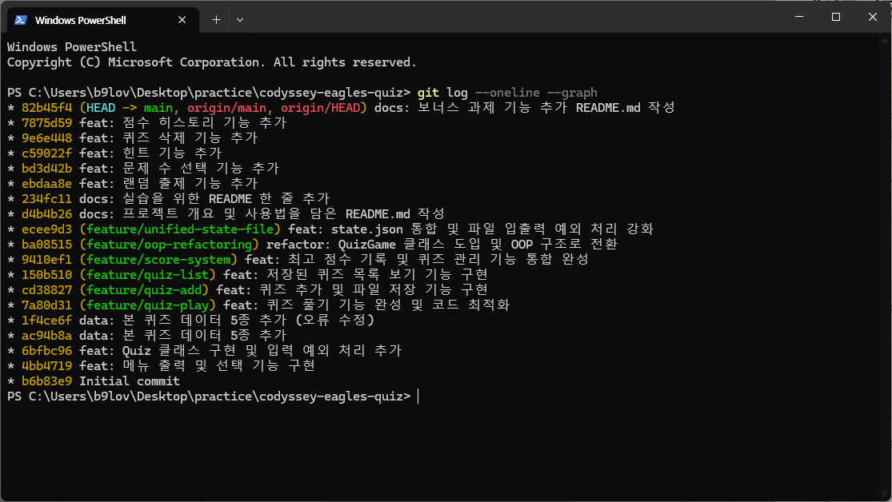

# 🦅 한화이글스 퀴즈 프로그램 (Hanwha Eagles Quiz Game)

KBO 리그의 열정적인 구단, **한화이글스**에 대한 지식을 테스트할 수 있는 CLI(Command Line Interface) 기반 퀴즈 프로그램입니다.

## 1. 프로젝트 개요
이 프로젝트는 파이썬의 기초 문법, 객체지향 프로그래밍(OOP), 파일 입출력(JSON), 그리고 Git을 통한 버전 관리를 학습하기 위해 제작되었습니다. 사용자는 퀴즈를 풀며 점수를 쌓고, 직접 새로운 문제를 추가하며 데이터를 관리할 수 있습니다.
## README 제출 체크리스트
| 목록 | 제출 |
| :--- | :--- |
| 프로젝트 개요 | O |
| 퀴즈 주제 선정 이유 | O |
| 실행 방법 | O |
| 기능 목록| O |
| 파일 구조| O |
| Git 커밋 컨벤션 | O |
| 데이터 파일 설명 | O |
| 프로젝트 증빙 | O |
| 브랜치 전략 및 작업 이력 | O |
| 데이터 저장 방식의 한계 및 확장 방안 | O |
| 데이터 백업 및 복구 전략 | O |
| 유지보수 및 확장 가이드 | O |
| 실행 화면 스크린샷 구성 예시(학습자 캡처) | O |

## 2. 퀴즈 주제와 선정 이유
*   **주제** : 한화이글스 (KBO 프로야구단)
*   **선정 이유** 
    *   풍부한 역사와 개성 넘치는 선수들이 많아 다양한 난이도의 퀴즈 구성이 가능합니다.
    *   데이터 구조(문제, 선택지, 정답)를 설계하고 관리하는 연습을 하기에 적합한 주제입니다.
    *   팬들의 열정을 담아 재미있게 학습 프로젝트를 진행할 수 있습니다.

## 3. 실행 방법
본 프로그램은 Python 3.x 환경에서 실행됩니다.

1. 저장소를 클론하거나 소스 코드를 다운로드합니다.
2. 터미널(또는 CMD)에서 해당 폴더로 이동합니다.
3. 아래 명령어를 입력하여 프로그램을 실행합니다.
   ```bash
   python main.py
   ```

## 4. 기능 목록
    - 퀴즈 풀기: 등록된 퀴즈를 순차적으로 풀고, 최종 점수를 확인합니다.
    - 최고 점수 기록: 이전 게임의 최고 점수를 저장하고, 기록 경신 시 알림을 제공합니다.
    - 퀴즈 추가: 사용자가 직접 문제, 4개의 선택지, 정답 번호를 입력하여 새 퀴즈를 등록합니다.
    - 목록 보기: 현재 등록된 모든 퀴즈의 질문과 정답을 확인합니다.
    - 데이터 영속성: 모든 데이터는 외부 파일에 저장되어 프로그램을 종료해도 유지됩니다.
    - 입력 검증: 잘못된 메뉴 선택이나 숫자가 아닌 입력에 대한 예외 처리가 되어 있습니다.
    - (보너스) 랜덤 출제
    - (보너스) 문제 수 선택
    - (보너스) 힌트 기능 : Quiz 클래스에 힌트 속성 추가, 힌츠 사용 시 점수 차감 로직을 구현
    - (보너스) 퀴즈 삭제
    - (보너스) 점수 히스토리 기능 : 모든 게임기록 및 날짜 시간, 점수 등 저장

## 5. 파일 구조
| 파일 | 역할 |
| :--- | :--- |
| .gitignore | Git 추적 제외 파일 설정 |
| README.md | 프로젝트 설명 문서 |
| main.py | Quiz 및 QuizGame 클래스가 포함된 메인 실행 파일 |
| state.json | 퀴즈 데이터와 최고 점수가 저장되는 JSON 파일 |

### 1. 클래스별 역할 및 책임 (Responsibility Separation)

본 프로젝트는 객체 지향 프로그래밍(OOP) 원칙을 준수하여 데이터 모델과 게임 로직을 분리하여 설계하였습니다.

*   **Quiz 클래스 (Data Model)**: 개별 퀴즈의 정보를 담는 데이터 모델 역할을 수행합니다. 퀴즈의 질문, 객관식 보기, 정답, 힌트 데이터를 캡슐화하며, 데이터를 JSON 직렬화가 가능한 딕셔너리 형태로 변환하거나 반대로 객체화하는 등 데이터 자체의 구조와 정합성을 관리하는 데 집중합니다.
*   **QuizGame 클래스 (Controller & Logic)**: 프로그램의 전체적인 흐름을 제어하고 게임 시스템의 로직을 담당하는 컨트롤러 역할을 수행합니다. `state.json` 파일을 통한 데이터의 영속성 관리(저장/불러오기), 퀴즈 출제 및 채점 로직, 점수 및 히스토리 기록, 그리고 사용자와 상호작용하는 메뉴 인터페이스를 총괄하여 운영합니다.

### 2. 객체지향 설계 적용 이유 (Class vs Function)

본 프로젝트는 단순한 함수 나열 방식이 아닌 **객체지향 프로그래밍(OOP)**을 적용하여 설계되었습니다. 그 이유는 다음과 같습니다.

#### 1) 객체지향 적용의 이점
*   **데이터와 로직의 결합 (Encapsulation)**: `Quiz` 객체는 질문, 정답, 힌트라는 **데이터**와 이를 관리하는 **메서드**를 하나로 묶어 관리합니다. 이를 통해 데이터 구조가 변경되어도 외부 코드에 미치는 영향을 최소화할 수 있습니다.
*   **상태 관리의 용이성**: `QuizGame` 클래스는 현재 점수, 게임 히스토리, 퀴즈 목록 등 프로그램의 **상태(State)**를 인스턴스 변수로 유지합니다. 함수형 방식에서 발생할 수 있는 과도한 전역 변수 사용을 방지하고 데이터 오염을 막습니다.
*   **코드 재사용성 및 확장성**: 새로운 기능(예: 타임어택 모드, 사용자 랭킹)이 추가될 때, 기존 코드를 수정하기보다 클래스를 상속받거나 새로운 클래스를 협력시키는 방식으로 유연하게 대처할 수 있습니다.

#### 2) 함수형 대안과의 비교
| 비교 항목 | 함수형 방식 (Procedural/Functional) | 객체지향 방식 (OOP, 본 프로젝트) |
| :--- | :--- | :--- |
| **데이터 관리** | 여러 함수에 인자를 전달하거나 전역 변수 사용 | 클래스 내부 멤버 변수로 상태를 안전하게 보관 |
| **코드 구조** | 기능 단위로 쪼개져 있어 흐름 파악이 어려울 수 있음 | '퀴즈', '게임 매니저' 등 실세계 객체 단위로 구조화 |
| **유지보수** | 데이터 구조 변경 시 관련 함수 전체를 수정해야 함 | 해당 클래스 내부 로직만 수정하여 영향도 최소화 |
| **가독성** | 프로그램 규모가 커질수록 함수 간 의존성 복잡화 | 책임이 분리되어 있어 각 클래스의 역할이 명확함 |

### 3. 입력 검증(Validation) 및 데이터 입출력(I/O) 분리 원칙

본 프로젝트는 프로그램의 안정성을 위해 사용자 입력 처리와 파일 데이터 관리의 책임을 명확히 분리하였습니다.

#### 1) 입력 검증 (Input Validation)
사용자가 메뉴 선택이나 퀴즈 풀이 중 잘못된 값을 입력하더라도 프로그램이 강제 종료되지 않도록 인터페이스 계층에서 검증을 수행합니다.
*   **검증 방식**: `try-except` 블록을 사용하여 숫자가 아닌 입력(ValueError)을 처리하고, `if` 조건문을 통해 허용된 범위(예: 메뉴 번호 1~6) 내의 값인지 확인합니다.
*   **예시**: 메뉴 선택 시 숫자가 아닌 문자를 입력하면 "숫자를 입력해주세요."라는 메시지를 출력하고 다시 입력을 받도록 설계되었습니다.

#### 2) 데이터 입출력 (Data I/O)
데이터의 저장과 불러오기는 `QuizGame` 클래스의 전용 메서드(`load_state`, `save_state`)에서만 전담하여 데이터 일관성을 유지합니다.
*   **처리 방식**: JSON 포맷을 사용하여 `state.json` 파일에 데이터를 저장하며, 파일이 없거나 손상된 경우를 대비해 예외 처리 로직을 포함합니다.
*   **예시**: 프로그램 시작 시 `state.json`이 없으면 기본 퀴즈 데이터로 초기화하여 실행하고, 데이터 변경(퀴즈 추가/삭제, 점수 기록)이 발생할 때마다 즉시 파일에 반영하여 데이터 유실을 방지합니다.

## 6. Git 커밋 컨벤션 (Commit Convention)

프로젝트의 변경 이력을 효율적으로 관리하기 위해 다음과 같은 커밋 메시지 규칙을 준수합니다.

### 커밋 메시지 구조
| 타입 | 의미 | 예시 |
| :--- | :--- | :--- |
| `feat` | 새로운 기능 추가 | feat: 힌트 기능 및 점수 차감 로직 추가
| `fix` | 버그 수정 | fix: 입력 값 예외처리 오류 수정
| `docs` | 문서 수정 (README 등) | docs: 클래스 역할 및 커밋 규칙 추가
| `refcact` | 코드 리팩토링 (기능 변경 없음) | refactor: QuizGame 클래스 메서드 분리
| `style` | 코드 포맷팅, 세미콜론 누락 등 | style: 코드 들여쓰기 및 주석 정리
| `chore` | 빌드 업무, 패키지 매니저 설정 등 | chore: .gitignore 설정 추가


## 7. 데이터 파일 설명 (state.json)
프로젝트의 모든 데이터는 state.json 파일에 저장되며, 크게 최고 점수, 게임 기록, 퀴즈 목록 세 부분으로 구성됩니다.

### 1. 메인 필드
| 필드명 | 설명 |
| :--- | :--- |
| `best_score` | 역대 최고 점수 기록 |
| `history` | 게임 플레이 이력 (날짜, 문제 수, 점수) |
| `quizzes` | 퀴즈 문제 은행 |

### 2. 퀴즈 객체 구조
- `question`: 문제 내용
- `choices`: 4지선다형 보기 (배열)
- `answer`: 정답 인덱스 (1~4)
- `hint`: 문제 힌트

### 3. 데이터 예시
```
{
  "best_score": 6.0,
  "history": [
    {
      "date": "2026-11-12 01:39:22",
      "total": 6,
      "score": 4.0
    }
  ],
  "quizzes": [
    {
      "question": "한화이글스의 연고지는?",
      "choices": ["대전", "대구", "서울", "부산"],
      "answer": 1,
      "hint": "교통의 요지"
    },
    {
      "question": "류현진 선수의 등번호는?",
      "choices": ["0", "1", "99", "100"],
      "answer": 3,
      "hint": "모르면 간첩"
    }
  ]
}
```
## 8. 프로젝트 증빙

*   **GitHub Repository URL**: [https://github.com/jongkyubae92/codyssey-eagles-quiz](https://github.com/jongkyubae92/codyssey-eagles-quiz)
*   **Git Log Graph**:
     


## 9. 브랜치 전략 및 작업 이력
- `feature/` 브랜치를 활용하여 기능별 단위 개발 진행
- 총 18개의 커밋으로 단계적 빌드업 증빙
- `git log --oneline --graph`를 통해 브랜치 생성 및 통합 이력 관리 확인

### 1. 브랜치 전략 및 병합 정책 (Branching Strategy)

본 프로젝트는 코드의 안정성을 유지하고 기능별 개발 이력을 명확히 관리하기 위해 브랜치 전략을 수립하여 운영하였습니다.

#### 1) 브랜치 전략: Feature Branch Workflow
*   **main**: 언제든 실행 가능한 상태의 '배포용' 소스코드를 관리하는 메인 브랜치입니다.
*   **feature/**: 새로운 기능 개발을 위한 브랜치입니다. (예: `feature/quiz-logic`, `feature/score-system`)
*   **fix/**: 버그 수정을 위한 전용 브랜치입니다.
*   **docs/**: 문서 작성 및 수정을 위한 브랜치입니다.

#### 2) 브랜치 분리 이유
*   **독립된 작업 환경**: 새로운 기능을 개발할 때 메인 코드에 영향을 주지 않고 자유롭게 테스트할 수 있습니다.
*   **이력 추적**: 특정 기능이 언제, 어떤 이유로 추가되었는지 커밋 히스토리를 통해 쉽게 파악할 수 있습니다.
*   **코드 안정성**: 개발 중인 불안정한 코드가 메인 프로그램에 섞이는 것을 방지합니다.

#### 3) 병합(Merge) 정책
*   **기능 검증**: `feature` 브랜치에서 기능 구현 및 단위 테스트가 완료된 경우에만 `main` 브랜치로 병합합니다.
*   **병합 방식**: 기능의 흐름을 남기기 위해 필요한 경우 병합 커밋을 생성하며, 병합 후 완료된 브랜치는 삭제하여 저장소를 청결하게 유지합니다.

## 10. 데이터 저장 방식의 한계 및 확장 방안

현재 본 프로젝트는 구현의 편의성과 가독성을 위해 **JSON 파일 시스템**을 사용하고 있습니다. 하지만 데이터 규모가 커질 경우 다음과 같은 한계가 있으며, 이를 위한 대안을 고려할 수 있습니다.

### 1) JSON 저장 방식의 한계
*   **메모리 효율성**: JSON 방식은 데이터를 읽을 때 파일 전체를 메모리에 로드해야 합니다. 퀴즈 데이터가 수십만 건으로 늘어날 경우 메모리 사용량이 급증합니다.
*   **I/O 성능 저하**: 단 하나의 데이터만 수정하더라도 파일 전체를 다시 써야 하므로, 데이터가 커질수록 쓰기(Write) 작업의 속도가 현저히 느려집니다.
*   **동시성 문제**: 여러 사용자가 동시에 데이터를 수정하려고 할 때, 파일 잠금(File Locking)이나 데이터 덮어쓰기 문제로 인해 데이터 무결성이 깨질 수 있습니다.
*   **검색 효율성**: 특정 조건의 데이터를 찾기 위해 전체 리스트를 순회해야 하므로 검색 성능이 O(n)으로 저하됩니다.

### 2) 대규모 데이터를 위한 대안 (Database)
향후 서비스 규모가 확장된다면 다음과 같은 방향으로 개선할 수 있습니다.
*   **SQLite (경량 DB)**: 별도의 서버 설치 없이 파일 형태로 운영되는 관계형 데이터베이스입니다. 인덱싱(Indexing)을 통해 빠른 검색이 가능하며, JSON보다 메모리 효율이 높습니다.
*   **RDBMS (MySQL, PostgreSQL)**: 데이터 간의 관계가 복잡해지고 다중 접속이 필요할 경우, 트랜잭션(Transaction)을 지원하는 관계형 DB를 도입하여 데이터 안정성을 확보할 수 있습니다.
*   **NoSQL (MongoDB)**: JSON과 유사한 문서(Document) 지향 구조를 가지면서도, 대규모 데이터 분산 처리와 빠른 읽기/쓰기에 최적화된 저장소를 사용할 수 있습니다.

## 11. 데이터 백업 및 복구 전략 (Backup & Recovery)

사용자의 소중한 데이터(퀴즈, 히스토리)를 보호하기 위해 본 프로그램은 이중 안전 장치를 갖추고 있습니다.

### 1) 자동 백업 시스템
*   **백업 시점**: `save_state()` 메서드가 호출될 때마다 기존의 `state.json` 파일을 `state.json.bak`으로 복사하여 보관합니다.
*   **목적**: 저장 과정에서 갑작스러운 전원 종료나 오류로 인해 파일이 깨지는 상황(Corruption)에 대비합니다.

### 2) 단계별 복구 프로세스
데이터 로드 시 문제가 발생하면 프로그램은 다음 순서로 복구를 시도합니다.
1.  **1단계 (정상 로드)**: `state.json` 파일을 읽어 데이터를 복원합니다.
2.  **2단계 (백업 복구)**: `state.json`이 없거나 파일이 손상된 경우, 자동으로 `state.json.bak` 파일을 찾아 데이터를 복구합니다.
3.  **3단계 (최종 방어선)**: 모든 파일이 없거나 복구가 불가능할 경우, 프로그램 내부에 정의된 `get_default_quizzes()`를 통해 기본 시스템 데이터를 생성하여 실행 중단을 방지합니다.

### 3) 수동 복구 방법
*   만약 사용자의 실수로 퀴즈를 잘못 삭제하고 저장했다면, 프로그램을 종료한 후 `state.json.bak` 파일의 이름을 `state.json`으로 변경하여 직전 저장 상태로 되돌릴 수 있습니다.

## 12. 유지보수 및 확장 가이드 (Maintenance Guide)

요구사항 변경 시 수정이 필요한 파일과 주요 메서드를 매핑한 가이드입니다. 본 프로젝트는 기능별로 메서드가 분리되어 있어 특정 부분만 수정하여 기능을 확장할 수 있습니다.

| 변경 요구사항 | 수정할 파일 | 수정할 메서드 / 위치 |
| :--- | :--- | :--- |
| **퀴즈 데이터 구조 변경** (예: 난이도 추가) | `main.py` | `Quiz` 클래스 `__init__`, `QuizGame.add_quiz` |
| **데이터 저장 방식 변경** (예: JSON → DB) | `main.py` | `QuizGame.save_state`, `QuizGame.load_state` |
| **점수 계산 정책 변경** (예: 힌트 감점 조정) | `main.py` | `QuizGame.play_quiz` 내 점수 합산 로직 |
| **메뉴 구성 및 UI 문구 변경** | `main.py` | `QuizGame.run` (메인 루프 및 print 문) |
| **데이터 검증 로직 강화** (예: 중복 문제 방지) | `main.py` | `QuizGame.add_quiz` 내 조건문 |
| **백업 정책 변경** (예: 백업 주기, 파일명) | `main.py` | `QuizGame.save_state` 내 `shutil.copy` 부분 |

### 상세 영향 분석
1.  **데이터 스키마 확장**: `Quiz` 클래스에 새로운 속성을 추가할 경우, `save_state` 시 `__dict__`를 사용하므로 저장 로직은 자동으로 대응되지만, `load_state` 시 객체를 생성하는 부분에서 인자 값을 맞춰주어야 합니다.
2.  **게임 로직 변경**: 퀴즈 진행 방식(시간 제한 추가 등)을 변경하고 싶다면 `play_quiz` 메서드만 집중적으로 수정하면 됩니다. 다른 관리 기능(추가/삭제)에는 영향을 주지 않습니다.
3.  **입출력 인터페이스**: 현재 CLI 기반에서 GUI나 웹으로 확장할 경우, `QuizGame`의 비즈니스 로직 메서드(add, delete, play)는 유지하고 `run` 메서드와 `print/input` 부분만 해당 프레임워크에 맞게 교체하면 됩니다.

## 13. 실행 화면 스크린샷 구성 예시(학습자 캡처)


* 이 프로젝트는 Git 실습을 위해 복제된 저장소에서 수정되었습니다.